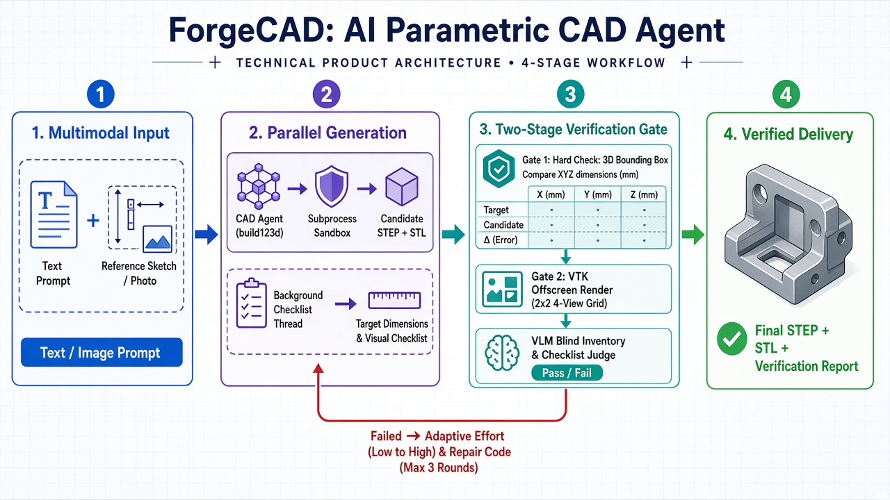

如果你尝试过用 AI 生成 3D 模型，大概率会遇到一个尴尬的现状：**好看的模型没法直接投入工程生产，而能用于生产的 CAD 代码，AI 又总是“画不对”。**

**ForgeCAD** 就是为了解决这个割裂而生的产品。它是一个支持“文本 + 图片”输入的多模态对话式 CAD Agent，目标很简单：**把自然语言描述或一张参考图，直接转化为尺寸精确、结构合理、可导入主流工业软件二次编辑的标准 `STEP` 模型。**

## 一、 3D 生成的痛点：为什么我们需要一个 CAD Agent？

目前市面上的 3D AIGC 主要走两条技术路线，但在工程制造、工业设计和家居结构件等场景下，各自都有明显的短板：

1. **视觉 Mesh 生成路线（扩散模型 / 图生 3D API）**
   这类模型擅长生成游戏资产、手办或雕塑。但它们输出的是三角网格（Mesh），没有参数化特征，拓扑结构往往杂乱无章，更谈不上毫米级的尺寸控制，无法直接用于 3D 打印结构件或机械加工。
2. **参数化代码生成路线（LLM + 几何内核 API）**
   让大模型调用底层的几何内核 API 编写参数化建模脚本，直接构建标准 B-Rep 实体几何（`STEP` 格式），天然具备精确尺寸和工程可编辑性。但这条路线有一个致命痛点：**“代码能跑通，不代表模型画对了。”**

随着基座模型代码能力的提升，AI 写出一段语法正确、不报错的建模代码已经不难；但大模型缺乏真正的三维空间知觉，在进行布尔运算、多部件装配或空间坐标变换时，极易产生**“静默几何错误”（Silent Geometric Errors）**——代码顺利返回 `ok=true`，导出的模型却是桌面悬空、孔位打偏、部件穿模，甚至长宽高差了一个数量级。

**ForgeCAD 要解决的核心问题，就是打通从“代码能跑通”到“几何真正确”的最后一公里。**

## 二、 ForgeCAD 是如何工作的？

为了让生成的 CAD 模型真正达到可交付标准，ForgeCAD 没有停留在“Prompt 调优 + 一次性代码执行”，而是构建了一套完整的**“多模态输入 → 参数化构建 → 双层校验 → 自适应修复”**闭环。

### 1. 多模态输入与边界克制

用户既可以用一句话描述需求（如“做一个 `120x80x5mm`、四角带 `M5` 沉头孔的安装板”），也可以直接上传一张产品草图或实物照片，或者图文混输。

- **以图定形，以文定尺**：当图文同时存在时，Agent 以图片确立几何拓扑与结构形态，以文字确立精确尺寸；未标注的尺寸则按工程常规比例估算并在回复中明确说明。
- **诚实拒答**：当图片过于模糊、与建模无关，且文字不足以确定具体物体时，Agent 不会强行脑补建模，而是主动提示缺失信息。

### 2. 基于 `build123d` 的参数化几何引擎

在具体的几何内核 API 选型上，ForgeCAD 采用 `build123d` 作为核心建模引擎。相比传统的链式调用接口，`build123d` 基于 Python 上下文管理器（`BuildPart`、`BuildSketch`、`BuildLine`）的构建语法层次更清晰，局部坐标系与布尔运算表达更直观，显著降低了大模型在复杂结构上的代码出错率。所有生成代码均在独立的子进程沙箱中运行，严格隔离语法、执行与导出各阶段的异常。

### 3. 核心壁垒：双层递进式自检闭环（Two-Stage Verification）

代码执行成功并生成候选几何后，并不会立刻交付给用户，而是进入两层严格的质量门禁：

- **第一层：三维包围盒硬校验（Hard Check）**
  在代码生成的同时，后台并发解析用户需求中的目标外廓尺寸。候选模型生成后，系统首先提取其实体包围盒（Bounding Box）进行尺寸比对。如果连整体长宽高都不对，直接拦截打回，无需消耗后续的渲染与视觉模型成本。
- **第二层：四视图渲染 + VLM 视觉验收（Visual Judge）**
  通过硬校验后，系统调用 VTK 进行离屏渲染（Off-screen Rendering），将模型从正前、正顶以及两个对角等轴测方向，渲染为一张带有特征边描边与尺寸标注的 `1024x1024` 四视图拼图。
  这里采用了一个关键的**“防幻觉两步审图法”**：
  1. **盲测清点（Inventory）**：如果不加处理地把原始需求（例如“画一张四条腿的桌子”）和渲染图一起喂给视觉大模型（VLM），模型极易产生“迎合心理”，明明只画出了三条腿也会判定通过。因此，系统第一步**隐去用户需求**，让 VLM 仅凭图片客观清点画中实际存在的部件名称、数量以及悬空、穿模等异常。
  2. **对照验收（Checklist Judge）**：第二步再将这份客观清点单、渲染图与验收清单对齐，逐项判定 `pass / fail / uncertain`。一旦存在关键项（Critical）未通过，具体的视觉观察结论会作为工具反馈回传给 Agent，驱动其修改代码（最多迭代 3 轮）。

### 4. 最优候选兜底与自动化评测基建

在多轮验证与修复过程中，所有中间产物仅保存在临时空间，不污染正式目录；系统会按“硬校验通过 > 关键缺陷最少 > 次要缺陷最少”的规则实时追踪最优候选解。即使遇到极端复杂的需求在 3 轮内未能完全通过，也会交付历史得分最高的版本并如实告知未通过项。

此外，项目内置了包含 80 个真实跨领域案例的 **CAD Benchmark v1**，覆盖机械零件、家具柜体、建筑构件等场景，对工具成功率、STEP 可加载率、包围盒准确率及端到端耗时进行自动化回归评测。

## 三、 构建 3D CAD Agent 的几点思考

在将 ForgeCAD 从早期的原型打磨为稳定可用产品的过程中，我们踩过不少坑，也对垂直领域的 Agent 设计形成了一些更为冷静的认知：

### 1. 产品定位做减法：不恋战黑盒 API，聚焦真正可控的价值

项目早期曾同时接入过外部商业图生 3D Mesh 的 API。但在实践中很快发现：一方面，第三方黑盒 API 单次调用成本高昂，且生成的是不可编辑的 Mesh，与参数化 CAD 属于完全不同的下游场景；另一方面，单纯做一层 API 转发，核心能力并不在自己手里。

果断砍掉外围 Mesh 接口、将所有精力收敛到“多模态输入 → 参数化 CAD 代码 → 闭环验证”这条主干道上，不仅降低了系统耦合度，也让产品的护城河真正建立在工程闭环之上。

### 2. 认清大模型的空间短板：验收标准必须与呈现媒介对齐

大模型在三维空间几何上的先验知识依然薄弱，复杂装配和曲面过渡很难靠一次生成搞定，**“靠验证把关”是现阶段的必然选择**。

但在设计验证环节时，极易犯一个错误：**让裁判去检查它根本看不见的东西**。例如，验证环节渲染的是纯灰色的 STL 几何白模，本身不包含任何材质、颜色或透明度信息；如果验收清单里生成了“桌面是否为透明玻璃”、“外壳是否为白色”这类检查项，视觉裁判就会永远判错，导致无意义的死循环重试。因此，在工程上强制剥离色彩与材质检查、仅保留几何与拓扑特征（如将“玻璃桌面”转化为“薄平板桌面结构”），是让视觉验证真正可用的关键细节。

### 3. Agent 架构的边界：不要把确定性的流程编排交给大模型

在设计“生成验收清单 → 写建模代码 → 渲染校验”的链路时，一个很自然的想法是：**为什么不把“生成清单”和“视觉校验”都做成独立的 Tool，放进同一个 Agent Loop 里，让大模型自己决定并行或串行调用？**

这看似很符合“自主 Agent”的教条，但在工程上却是一笔亏本买卖：

- **伪并发与耗时叠加**：当开启推理模式（Thinking）时，即便让模型在一次回复里输出两个工具调用，它也必须先串行思考完清单和完整 CAD 代码才能返回，根本无法实现“边写代码边准备清单”的真并发。
- **职责耦合（运动员兼任裁判）**：同一个上下文既写代码又列验收标准，模型极易顺着自己代码的偷懒之处去降低验收标准，失去独立第三方审查的意义。
- **上下文污染**：如果把视觉审查暴露在主对话历史中，高达数千 Token 的多视图图片会留在主上下文里，导致后续每一轮代码修复都重复为图片买单。

因此，ForgeCAD 最终选择了**“外层 Agent Loop 负责创造与修复，内层确定性管线（Pipeline）负责并发与验收”**：主模型只管专注写好建模代码；而清单的后台线程并发生成、子进程渲染、VLM 盲测审图，全部由确定性的 Python 工程代码在工具内部悄无声息地完成，最终只把几百字的纯文本审查结论回传给主模型。**好的 Agent 架构，不是让模型接管一切，而是让模型只做它最擅长的非确定性推理，用确定性的代码守住质量、速度与成本的底线。**

### 4. 推理时代的成本与延迟博弈：按需分配算力

推理模型（Thinking Mode）极大提升了复杂 CAD 代码的生成上限，但全量开启高强度思考（High Effort）加上多轮视觉校验，很容易让单次等待时间超过两分钟。为了在体验与质量之间取得平衡，我们在工程细节上做了大量“抠门”的优化：

- **自适应推理强度（Adaptive Effort）**：首轮生成默认采用 `low` 推理强度快速出初稿——对于大多数常规需求，这已经足够一次通过；只有当视觉校验返回 `failed`、需要针对具体缺陷攻坚修改时，系统才自动将下一轮推理强度升档为 `high`，通过后立即降回 `low`。
- **零冗余几何执行**：在候选验证阶段一次性导出临时的 `STEP` 与 `STL`，一旦校验通过，直接通过文件级移动发布为正式产物，绝不为了保存 `STEP` 而把耗时数秒的 CAD 代码再跑第二遍。
- **视觉 Token 压缩**：无论是验证环节将四个视角压进单张 `1024x1024` 网格图并关闭审查模型的 Thinking，还是输入端利用多模态接口的自适应缩放机制，核心原则都只有一条——**把每一分 Token 和每一秒延迟，都花在真正影响几何质量的刀刃上。**

## 结语

3D CAD 生成正处于从“玩具演示”走向“工程可用”的拐点。ForgeCAD 的探索证明了：即使基座模型在三维空间直觉上仍有局限，通过**恰当的几何内核抽象、对抗幻觉的视觉验证闭环，以及克制务实的 Agent 工程架构**，我们依然能够构建出一个稳定、可控、能交付工业级标准件的 CAD 智能体。
